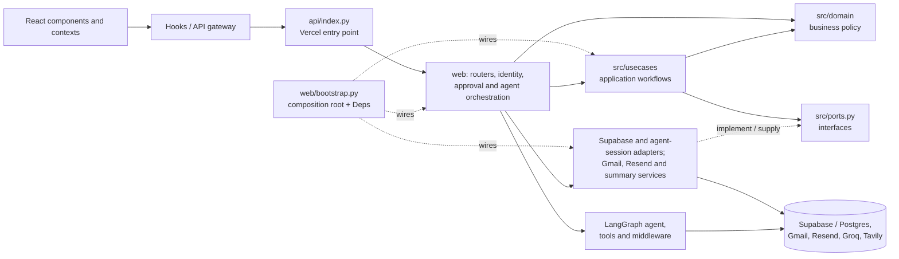
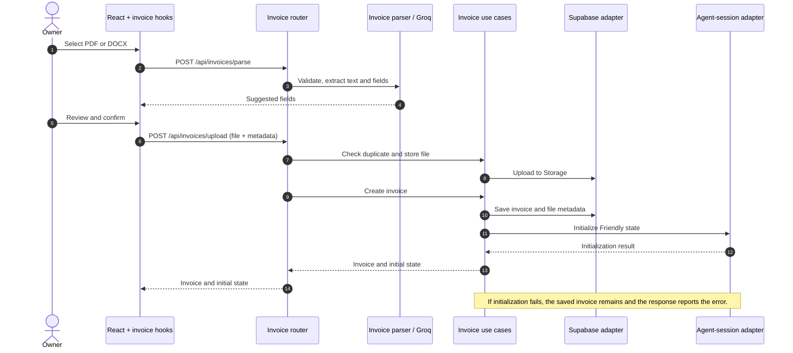
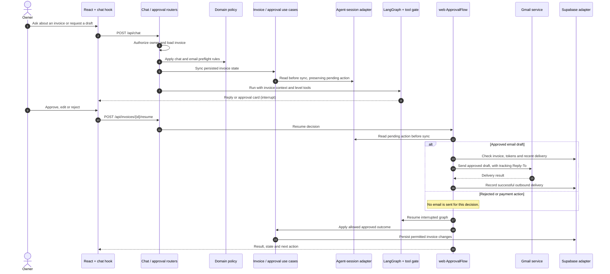
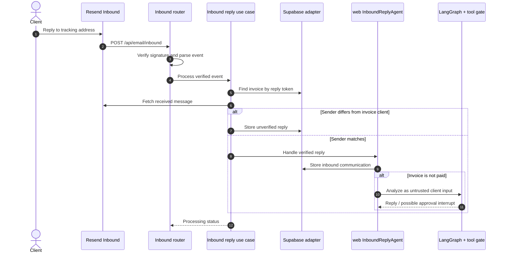
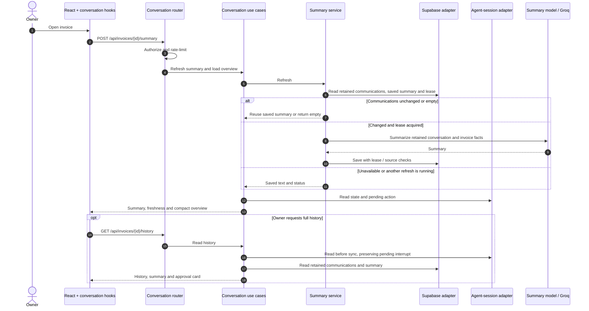
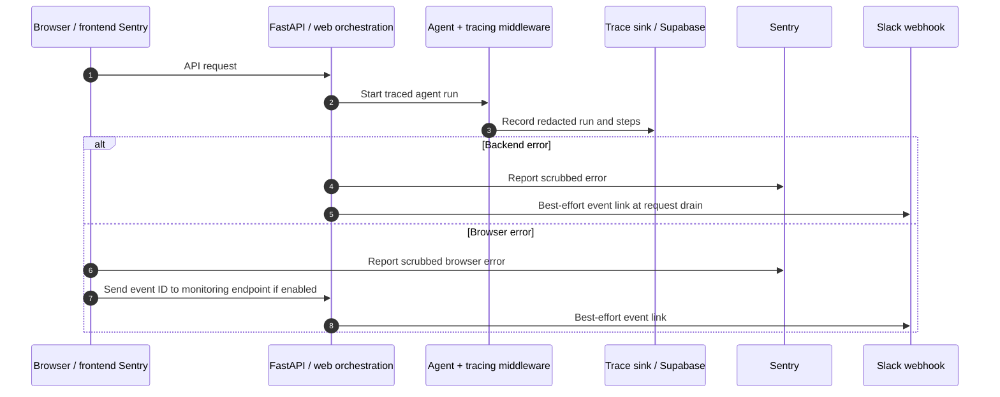

# InvoiceChaser

An AI assistant for chasing unpaid invoices. Upload or generate an invoice, ask the agent to prepare a reminder, and review each email before it leaves your Gmail. Client replies are tracked through Resend and analyzed for the next step; escalation remains the owner's decision.

[Live app](https://invoice-chaser-chi.vercel.app/) · [Architecture](#clean-architecture) · [Flows](#important-flows) · [Setup](#getting-started) · [Operations](#operations-and-evaluation)

## What it does

- Parses PDF and DOCX invoices, or creates a PDF with the invoice generator.
- Offers Friendly, Formal and Legal escalation levels, with tools and prompts gated by level. Legal research uses Tavily.
- Pauses email drafts and payment-status tools for approval. Drafts can be edited or rejected; Gmail access is send-only.
- Tracks replies through a per-invoice Reply-To address and a signed Resend webhook. The agent treats client content as untrusted.
- Tracks payments, settlement and approved promises to pay. The dashboard shows pending decisions and invoice status.
- Saves an AI conversation summary when an invoice is opened and its communications have changed. Full history remains available on request.
- Supports a guest/demo experience, agent traces, golden-set evaluations and optional Sentry monitoring.

## Clean architecture



The domain uses only the Python standard library. Use cases depend on domain rules and ports; adapters provide external capabilities. HTTP validation, identity and some agent/approval orchestration live in `web/`. The frontend's components and contexts access the API through hooks. `web/bootstrap.py` wires the live dependencies, while mutable `Deps` collaborators are read at call time so tests and evaluations can replace them. Architecture tests enforce these boundaries.

`api/index.py` remains the deployed ASGI entry point. Invoice business writes such as escalation and settlement go through `InvoiceUseCases`, while approved payment outcomes go through `ApprovalUseCases`; integration bookkeeping such as reply tokens and email delivery records also uses the store. The persisted invoice is the source of truth for agent state.

## Important flows

These diagrams show runtime calls across the boundaries above. Arrows to a store or session represent calls through an injected port or dependency; the concrete production implementation is named where useful.

### 1. Parse and create an invoice



Manual creation uses `POST /api/invoices`. For generated PDFs, the frontend uploads the PDF and then registers it via `/api/invoices/generated`; the agent starts when chat opens. Creation does not itself send an email.

### 2. Chat, approval and sending



Demo mode does not send email. Missing Gmail credentials, duplicate delivery and send failures are reported as delivery outcomes. A paid invoice cannot be resumed for another send. The approval flow sends and records a successful email before resuming the graph; it does not promise transactional delivery if recording fails after Gmail accepts a message.

### 3. Inbound client reply



Invalid signatures are rejected; events without a matching token are ignored. Matching the sender permits analysis, but the message itself remains untrusted. The stored inbound body is limited to 2,000 characters.

### 4. Payment, escalation and settlement

```mermaid
sequenceDiagram
    autonumber
    actor Owner
    participant HTTP as Chat / approval / invoice routers
    participant Agent as LangGraph agent
    participant Flow as ApprovalFlow
    participant UC as Approval / invoice use cases
    participant Policy as Domain invoice policy
    participant DB as Supabase adapter
    participant Session as Agent-session adapter
    Owner->>HTTP: Ask to record a promise or payment
    HTTP->>Agent: Run agent
    Agent-->>Owner: Payment action awaiting approval
    Owner->>HTTP: Approve or reject
    HTTP->>Flow: Resume decision
    Flow->>Agent: Resume graph
    Flow->>UC: Apply approved tool outcome
    UC->>Policy: Validate allowed fields and values
    UC->>DB: Write permitted changes only
    Note over UC,DB: Email approvals do not commit payment fields; paid invoices cannot be reopened by a late approval.
    opt Owner chooses Escalate
        Owner->>HTTP: POST /api/invoices/{id}/escalate
        HTTP->>Policy: Determine next level
        HTTP->>UC: Persist higher level
        HTTP->>Agent: Request draft at new level
        Agent-->>Owner: Draft requires approval
    end
    opt Owner chooses Settle
        Owner->>HTTP: POST /api/invoices/{id}/settle
        HTTP->>UC: Settle invoice
        UC->>DB: Mark paid and record settlement
        UC->>Session: Sync saved invoice state
    end
```

A promise to pay can save a validated `follow_up_date` when its pending action is approved. Settlement stops further chasing and hides pending approval cards. Conditional writes protect the paid state from a racing approval.

### 5. Saved summary and conversation history



New messages, polling and history reads do not themselves generate summaries; a later opening triggers refresh. The summary is separate from the full history and may be stale or unavailable without blocking chat. See [summary API and operations](docs/conversation-summary.md) for statuses, leases, limits and evaluation.

### 6. Tracing and error alerts



Agent traces and Sentry serve different purposes: traces explain agent runs; Sentry reports runtime errors. Slack alerts are optional and best-effort, not a durable queue. See [monitoring configuration and privacy](docs/sentry.md).

## Observability and evaluation

**Built-in agent traces.** Agent runs record model and tool steps, human decisions, delivery outcomes, timing and usage in Supabase. Trace payloads are redacted and capped; writes fail open so a tracing outage does not break the invoice workflow. Inspect the invoice's Trace tab or the trace API. `/api/health` exposes trace counters, including dropped writes.

**LangSmith.** Optional LangChain tracing runs alongside the built-in tracer. Set `LANGSMITH_TRACING` and `LANGSMITH_API_KEY`, then either `LANGSMITH_AGENT_ID` plus `LANGSMITH_AGENT_ENVIRONMENT`, or `LANGSMITH_PROJECT`. Search LangSmith metadata `trace_run_id` using the response's `X-Trace-Id`. Agent inputs can contain client data; `.env.example` documents options to hide inputs and outputs. Tests and evaluations disable LangSmith.

**Sentry and Slack.** Optional frontend and backend Sentry projects capture runtime faults with request-data scrubbing; source maps can be uploaded during builds. Backend events and opted-in browser events can send an event-specific Sentry link to Slack through a server-side webhook. Alerts are best-effort and may be lost on a cold start; Sentry remains the issue tracker. Configuration, data handling and verification are in [the monitoring guide](docs/sentry.md).

### Golden evaluation gates

The chasing-agent golden set in `evals/golden/` exercises each level, including untrusted prompt-injection cases. The harness runs the real API and agent graph with a fake database, a Gmail outbox and canned search, then evaluates traces, tool choices, approval behavior, draft rules and an independent tone judge. Scripted cases run deterministically in pytest; the live model evaluation uses `python -m evals.run`.

| Chasing-agent live gate | Required result |
| --- | --- |
| Approval and email cards | Approval invariant holds in every run; every expected email card appears with zero pre-approval deliveries. |
| Tool choice | At least 90% accuracy overall. |
| Tone judge | Mean at least 4/5 and no more than 10% judge errors. |
| Baseline regression | Per-level tool accuracy, approval and tone-rule rates drop by no more than 10 percentage points; judge mean drops by no more than 0.5 points. |
| Completion | A provider daily-quota abort fails the run. |

The separate summary golden evaluation uses a different-family judge to assess grounding, coverage, attribution and safety. Each criterion must score at least 4/5 with an explicit positive verdict. Single summaries, complete update sequences and individual sequence checkpoints each require at least 85% positive results; missing or failed evaluations do not pass. See [summary evaluation](docs/conversation-summary.md#summary-golden-evaluation) for fixtures and sequence details. Required CI gates check change classification and require successful trusted live evaluations when relevant files change; evaluation credentials must remain separate from production.

## API and project map

| Interface | Purpose |
| --- | --- |
| `/api/auth/google/*`, `/api/auth/gmail/*` | Sign in and connect send-only Gmail |
| `POST /api/invoices/parse`, `/upload`, `/generated/upload`, `/generated` | Parse, upload and create invoices |
| `GET/POST /api/invoices`, `PATCH /api/invoices/{id}/details` | List, create and update invoices |
| `POST /api/chat`, `/api/invoices/{id}/resume`, `/escalate`, `/settle` | Chat and make invoice decisions |
| `GET/POST /api/invoices/{id}/summary`, `GET /api/invoices/{id}/history` | Summary-first overview and full conversation |
| `POST /api/email/inbound` | Signed Resend webhook |
| `/api/invoices/{id}/traces`, `/api/health` | Trace inspection and operational health |

See the running app's `/docs` for the full API schema.

| Path | Responsibility |
| --- | --- |
| `api/index.py`, `web/bootstrap.py` | Vercel entry point and dependency composition |
| `web/routers/`, `web/identity.py`, `web/approval.py` | HTTP, authorization and approval orchestration |
| `src/domain/`, `src/ports.py`, `src/usecases/` | Policy, interfaces and application workflows |
| `src/adapters/`, `src/services/` | Persistence, agent sessions and integrations |
| `src/agent.py`, `src/tools/`, `src/middleware/` | LangGraph agent, tools, gates and tracing |
| `frontend/src/hooks/`, `frontend/src/components/` | API-facing hooks and React views |
| `supabase/schema.sql`, `tests/`, `evals/` | Database setup, automated tests and agent evaluations |

## Getting started

Requirements: Python 3.13 (the CI version), Node.js 20.19+ or 22.12+, and configured Groq, Supabase, Google OAuth, Tavily and Resend services as needed. Copy `.env.example` to `.env` and follow its descriptions; never commit credentials.

```bash
git clone https://github.com/code0monkey1/invoice-dispute-agent.git
cd invoice-dispute-agent
python -m venv .venv
source .venv/bin/activate
pip install -r requirements.txt
npm --prefix frontend install
cp .env.example .env
```

Apply `supabase/schema.sql` in Supabase. Configure Google OAuth and the frontend callback URL; connect Gmail separately using the `gmail.send` scope. For reply tracking, configure the Resend inbound domain, API key and signed webhook at `/api/email/inbound`. A public URL or tunnel is needed for webhook testing.

```bash
# Terminal 1
uvicorn api.index:app --reload --port 8000

# Terminal 2
cd frontend && npm run dev
```

Open http://localhost:5173. Vite proxies `/api` to the backend.

## Operations and evaluation

Run the project checks from the repository root:

```bash
.venv/bin/python -m pytest -q
cd frontend
npm test
npm run lint
npm run build
```

The deterministic evaluation tests run with pytest. The live chasing-agent golden set (`python -m evals.run`) and summary evaluation (`python -m evals.summary`) use provider models and have separate CI gates. For prompt, tool or agent changes, use the dedicated evaluation Groq organization, run one evaluation at a time, and preserve the existing baselines and thresholds. See [summary evaluation](docs/conversation-summary.md#summary-golden-evaluation) and the workflows in `.github/workflows/`.

Production runs on the existing Vercel project `invoice-chaser`. Set the required environment variables from `.env.example` in the deployment environment. For persistent LangGraph checkpoints, configure `DATABASE_URL` with the dedicated `langgraph_checkpointer` role and run `python -m src.checkpoint_setup` after deploying compatible code; repeat after checkpointer upgrades. Check `/api/health` for `status: ok` and `checkpointer.store: postgres`. Consult [CLAUDE.md](CLAUDE.md) and [Sentry operations](docs/sentry.md) for deployment and monitoring details.

## License

MIT
