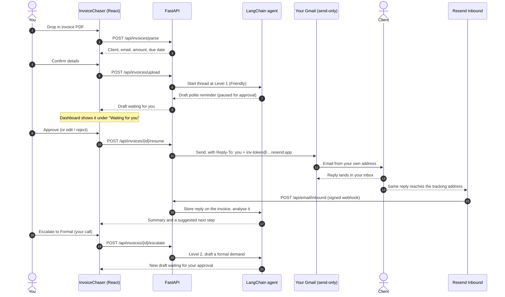
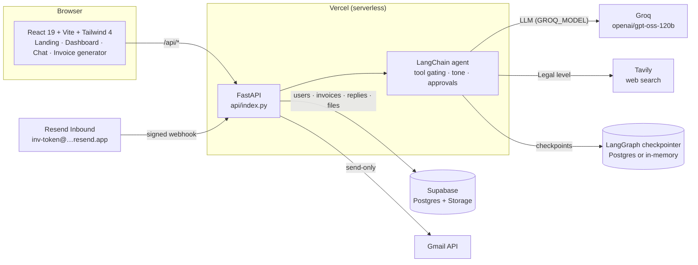

<div align="center">

# InvoiceChaser

### An AI agent that chases unpaid invoices. You approve the emails.

Drop in an overdue invoice. The agent reads it, drafts each reminder, reads the client's replies and suggests when to get firmer, from friendly to formal to legal. Nothing is sent from your Gmail until you approve it.

**Built with LangChain · LangGraph · Groq · FastAPI · React · Supabase · Resend**

[Live app](https://invoice-chaser-chi.vercel.app/) &nbsp;&bull;&nbsp; [How it works](#how-it-works) &nbsp;&bull;&nbsp; [Architecture](#architecture) &nbsp;&bull;&nbsp; [Setup](#getting-started) &nbsp;&bull;&nbsp; [Agent design](#how-the-agent-is-built)

</div>

---

## How it works

<p align="center">
  
</p>

You do three things. The agent does the rest:

1. **You add the invoice.** Upload the PDF or DOCX you already sent, or create one with the built-in invoice generator.
2. **You approve each email.** The agent drafts every message. You approve, edit or reject it before anything is sent.
3. **You decide when to get firmer.** The agent reads each client reply and suggests the next step. Escalating from Friendly to Formal to Legal is always your call.

### The full lifecycle, step by step



---

## Features

| Feature | What it does |
|---|---|
| **Invoice PDF parsing** | Reads a PDF or DOCX (up to 10 MB) and fills in the invoice number, client, email, amount, due date and jurisdiction. Uses the LLM, with a pattern-matching fallback. Scanned images aren't supported. |
| **Invoice generator** | Creates an invoice PDF from three templates (Modern, Classic, Minimal) with an optional payment link (Stripe, Lemon Squeezy, PayPal), then hands it straight to the agent. |
| **Three escalation levels** | Friendly, Formal and Legal. Each level unlocks different tools and a different tone of voice. |
| **Approval on every send** | Every email draft, and every payment-status change, pauses for your approval. You can edit the draft before it sends. |
| **Escalation on your terms** | The "Escalate" button raises the level directly and asks the agent for a draft in the new tone. It doesn't depend on the model deciding to escalate. |
| **Sends from your Gmail** | Uses Google's `gmail.send` scope only. InvoiceChaser can send the emails you approve, but it can't read your inbox. |
| **Reply tracking** | Each email carries a unique Reply-To address. Client replies reach your inbox and, through Resend Inbound, the invoice's timeline, where the agent analyses them. |
| **Small-claims research** | At the Legal level, the agent looks up small-claims procedures for the client's jurisdiction (Tavily web search) and can write a court-filing guide. This is information, not legal advice. |
| **Dashboard** | A "Waiting for you" queue of drafts needing approval, the amount outstanding and collected, and every invoice's current status in plain language. |
| **Demo mode** | Try everything without signing up. Demo data stays in your browser session, and no emails are sent. |

> **Removed for now:** late-fee calculation and Telegram notifications. Neither is offered in the app or advertised on the site.

---

## Architecture



### API endpoints

| Endpoint | Purpose |
|---|---|
| `GET /api/auth/google/url` | Sign-in link with basic profile access only (no warning screen) |
| `GET /api/auth/gmail/connect-url` | "Connect Gmail" link asking for `gmail.send` only (signed-in users) |
| `POST /api/auth/google/callback` | Exchanges the OAuth code. Saves Gmail access only if `gmail.send` was granted |
| `POST /api/invoices/parse` | Extracts invoice fields from a PDF or DOCX (works for guests too) |
| `POST /api/invoices` · `POST /api/invoices/upload` | Creates an invoice and starts the agent thread |
| `GET /api/invoices` | Lists invoices, including `awaiting_approval` for the dashboard queue |
| `POST /api/chat` | Talks to the agent about one invoice. Clearly off-topic questions are filtered out |
| `POST /api/invoices/{id}/escalate` | Raises the level and asks the agent for a draft in the new tone |
| `POST /api/invoices/{id}/resume` | Approve, edit or reject the waiting draft. Approved emails are sent via Gmail |
| `POST /api/email/inbound` | Resend webhook for client replies (Svix signature verified) |

---

## How the agent is built

### Escalation levels and tool gating

The agent only sees the tools for its current level (`src/middleware/dynamic_tools.py`), and its system prompt changes with the level (`src/middleware/dynamic_prompts.py`, prompts in `src/prompts/v1/`).

| Level | Tone | Tools added |
|---|---|---|
| **0 · Setup** | n/a | `update_invoice_details`, `check_invoice_status`, `draft_invoice_delivery_email` |
| **1 · Friendly** | Warm, assumes good faith | `draft_polite_reminder`, `escalate_dispute`, payment-status tools |
| **2 · Formal** | Firm, businesslike | `draft_formal_demand_letter` |
| **3 · Legal** | Final notice | `draft_final_notice`, `lookup_small_claims_procedures`, `generate_court_filing_guide` |

The day ranges shown on the site (7–30, 30–60, 60+ days late) are guidance for you. They aren't thresholds in the code.

### Human in the loop

`HumanInTheLoopMiddleware` (in `src/agent.py`) pauses the agent whenever it calls one of these tools:

| Pauses for your approval | Runs without approval |
|---|---|
| `draft_invoice_delivery_email`, `draft_polite_reminder`, `draft_formal_demand_letter`, `draft_final_notice` | `check_invoice_status`, `update_invoice_details`, `escalate_dispute` |
| `mark_invoice_pending`, `mark_invoice_paid`, `record_partial_payment` | `lookup_small_claims_procedures`, `generate_court_filing_guide` |

When you approve, `/resume` reads the waiting draft **before** syncing invoice details into the agent. LangGraph's `update_state()` clears a pending interrupt, so reading it afterwards would lose the draft. It then sends the email to the client address saved on the invoice, and reports `email_status`: `sent`, `demo`, `gmail_not_connected` or `failed`.

### State, memory and context

- **Agent state** (`src/state.py`): client, amounts, days overdue, jurisdiction, escalation level and status, persisted per invoice thread (`invoice-{id}`) by the LangGraph checkpointer (Postgres when `DATABASE_URL` is set).
- **Source of truth:** the Supabase `invoices` table. Only fields that have changed are written into the agent, so a waiting draft isn't wiped when you open an invoice.
- **Runtime context** (`FreelancerContext`): your name, business and payment terms, injected per request.

---

## Tech stack

| Layer | Technology |
|---|---|
| LLM | Groq, model set by `GROQ_MODEL` (default `openai/gpt-oss-120b`, which supports tool calling) |
| Agent | LangChain (`create_agent`, middleware, tools); LangGraph for checkpoints and `Command` |
| Backend | FastAPI on Vercel serverless (Python) |
| Data | Supabase Postgres + Storage (invoice files) |
| Email | Gmail API (send-only) for sending; Resend Inbound (free plan) for replies |
| Search | Tavily (Legal level only) |
| Frontend | React 19, Vite, Tailwind CSS 4, Vitest |

---

## Project structure

```
api/index.py                  FastAPI routes: auth, invoices, chat, escalate, resume, inbound email
src/
  agent.py                    Agent assembly, approval middleware, checkpointer
  state.py                    Agent state + FreelancerContext
  invoice_parser.py           PDF/DOCX text extraction + LLM field extraction (with fallback)
  db.py                       Supabase REST access, encrypted Gmail tokens, reply-token lookup
  tools/                      drafting, escalation, invoice status, legal research, payment status
  middleware/                 dynamic tools and prompts per escalation level
  prompts/v1/                 System prompts for levels 0–3
  services/
    gmail_service.py          Send-only Gmail client (supports Reply-To)
    resend_inbound.py         Reply tokens, webhook signature check, received-email fetch
frontend/src/
  components/                 LandingPage, Dashboard, InvoiceTable, ChatPanel, DraftApproval, invoice-generator/
  contexts/AuthContext.tsx    Sign-in, Connect Gmail, demo mode
  hooks/                      useChat (approve, reject, escalate), useInvoices
supabase/schema.sql           Tables, including invoices.reply_token
tests/                        Backend tests (pytest)
docs/how-it-works.svg         The animated flow above
```

---

## Getting started

### Prerequisites

- Python 3.11+ and Node.js 18+
- Free accounts: [Groq](https://console.groq.com), [Tavily](https://app.tavily.com), [Supabase](https://supabase.com), a Google Cloud OAuth client, and [Resend](https://resend.com) (free plan, no card)

### Install

```bash
git clone https://github.com/code0monkey1/invoice-dispute-agent.git
cd invoice-dispute-agent
python -m venv .venv && source .venv/bin/activate
pip install -r requirements.txt
cd frontend && npm install && cd ..
cp .env.example .env
```

Fill in `.env`. Every variable is described in `.env.example`.

### Configure the services

1. **Supabase:** run `supabase/schema.sql` in the SQL editor. It's safe to re-run, and it adds `invoices.reply_token`.
2. **Google OAuth:** on the consent screen, request `openid`, `userinfo.email`, `userinfo.profile` and `gmail.send` only. Set the redirect URI to `http://localhost:5173/auth/google/callback` (plus your production URL). Send-only access needs Google's free verification, not the paid security assessment.
3. **Resend Inbound:**
   - Copy your receiving address (`<id>.resend.app`) into `RESEND_INBOUND_DOMAIN`, and create an API key.
   - Add an `email.received` webhook pointing to `https://<your-app>/api/email/inbound`, and put its signing secret in `RESEND_WEBHOOK_SECRET`.
   - Resend can't reach `localhost`, so test replies on a deployed URL or through a tunnel.

### Run locally

```bash
# Terminal 1: backend (the Vite dev server proxies /api to port 8000)
uvicorn api.index:app --reload --port 8000

# Terminal 2: frontend
cd frontend && npm run dev
```

Open http://localhost:5173.

### Tests

```bash
pytest                       # backend
cd frontend && npm run test  # frontend
```

---

## Deploy to Vercel

`vercel.json` builds the frontend and serves every route through `api/index.py`. In the Vercel project, set the same variables as `.env`, including `GROQ_MODEL`, `RESEND_API_KEY`, `RESEND_INBOUND_DOMAIN` and `RESEND_WEBHOOK_SECRET`. Then point the Resend webhook at `https://<your-app>/api/email/inbound`.

---

## License

MIT
